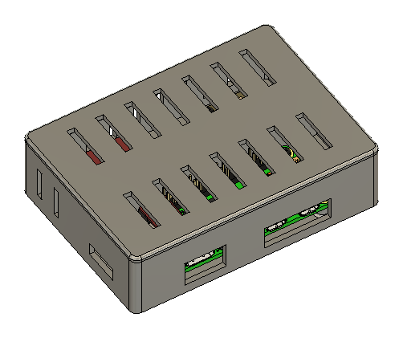

# Lab sensor node

Pilot lab sensor node, used to run minimalQMS end to end before QMS-rev A.

## Why it exists
<!-- The problem it solves and where it is used. Written at G0. -->
A minimal hardware unit that can be deployed in self-driving labs. It is also a hardware
pilot: it is iterated through minimalQMS to test and fix the QMS before QMS-rev A.
(Approved at G0, 2026-11-23; see `00_planning/plan.yaml`.)

## Key specs
- Measures temperature, humidity, pressure (BME280) and a VOC air-quality index (SGP40).
- Raspberry Pi Zero 2 W, Wi-Fi; wall-powered through a UL-listed supply; no soldering.
- 3D-printed PETG housing, about 95 x 68 x 26 mm; 15 to 35 °C, 20 to 80 %RH indoors.
- Monitoring only: not a certified safety or gas alarm.
Full list: `01_requirements/requirements.yaml`.

## Status

| | |
|---|---|
| Current stage | Build and verify (G3 + G4 next); G2 approved 2026-11-27 |
| Approved for build | LSN-A-0001 rev A (not released) |
| Released revision | none yet |
| Units built | 0 (build B001: 2 units, parts being ordered) |

## Where things are
| What | Where |
|---|---|
| Plan, gates, ECR list | `00_planning/plan.yaml`, `00_planning/ecrs.csv` |
| Requirements and risks | `01_requirements/` |
| **Every review finding and its decision (what is still open)** | `02_design/reviews/findings.csv` |
| Review packages and minutes | `02_design/reviews/DR-nnn/` |
| Sources of the build document (steps, pictures, BOM source, make files) | `02_design/build_document/` |
| Test procedures, analyses, test tools | `02_design/test_procedures/` |
| Software (its own item) | `02_design/software/lsn-node/` |
| **The build document to build from** (instructions, A01 BOM, A02 make files, A03 tests, A04 traveller) | `03_build_package/` |
| **What to order for a build** (reqs per supplier, totals, stock, checklist) | `builds/B00n/order_sheet.md` (upload file per supplier beside it) |
| Filled travellers and test results | `builds/B00n/` |
| Suppliers; orders as placed | `purchasing/suppliers.csv`; `purchasing/purchases.csv`, `purchasing/requisitions/` |
| Test equipment | `equipment/equipment.csv` |
| Problems with minimalQMS itself | `qms/qms-findings.csv` |
| Session log and time | `worklog.md` |

## Variants
<!-- One row per top assembly, once there is more than one. -->

## Reproduce it
Available after the first release: the build package (`03_build_package/`) at a release tag
has everything needed to buy, make, build and test the product.

## Scorecard
<!-- Agent and human time per activity, from 00_planning/scorecard.csv, after each iteration. -->

## History
<!-- Iterations, with links to their reviews and lessons learned. -->

---
Developed with [minimalQMS](https://github.com/kelvinchow23/minimal-qms). Project code `LSN`.
